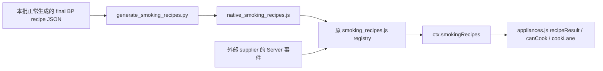

# 三槽爐灶：配方來源與供應契約

## 執行路徑

Java 固定基準是 [StoveBlockEntity.java@e59e3dbc](https://github.com/breezeth-CN/OrdertoCook/blob/e59e3dbcabe19b783d9adb933db5fcb8bc1e4642/forge-1.20.1/src/main/java/cn/breezeth/ordertocook/block/entity/StoveBlockEntity.java)。
`RecipeManager.createCheck(RecipeType.SMOKING)` 和 `getRecipe` 讀所有已載入的煙燻配方，沒有按模組 namespace 篩選。
每槽消耗 1 個輸入，按 recipe 的產物及數量出料。

Bedrock 的正常來源鏈：



`smoking_recipes.js` 保留原有 9 條 vanilla 基本配方。其他供應資料讀正常生成的
[`native_smoking_recipes.js`](../runtime/BP/scripts/native_smoking_recipes.js)，取代舊的兩條手寫 Grilling 清單。
這是唯讀供應資料，不是第二個可變 registry。每個 provider 使用既有 `main` catalog，初始化時過濾不存在的 ItemTypes，直接交同一個 `registerProvider`。
沒有同包 self-publisher、事件轉送、輪詢、握手或逐配方授權表。

`appliances.js` 保留既有三組對應輸入／輸出、燃料、200 tick 批次、原生堆疊上限、原物品扣取、失敗回復、UI 與存檔方式。
`recipeResult` 建立指定數量產物，`canCook` 查容量，`cookLane` 扣 1 個原料並加入真產量。本次不更動該檔、洗碗或存檔 schema。

## 正常家族生成接點

同一個家族 `generate-batch` 必須依序完成：

1. 從本批固定來源正常生成／完成所有 BP 的 recipe 資料，包括來源修復及整合後的最終版本。
2. 由這一批的 final BP 輸入，執行 OTC `generate:smoking`，把模組寫進本批 OTC runtime。不可沿用上一批模組來代表新一批 recipes。
3. 再按既有程序分配新配對身份、凍結 payload／baseline／release-history，正常封裝與發行。既有 `tools/build.py` 會包含這個由 `smoking_recipes.js` import 的模組。

生成入口不帶測試或封裝：

```sh
npm run generate:smoking -- \
  --pack /absolute/final-source-A/BP \
  --pack /absolute/final-source-B/BP \
  --output runtime/BP/scripts/native_smoking_recipes.js \
  --provenance dist/native-smoker-sources.json
```

以上是通用路徑示例，不是固定包清單。`--pack` 由同一批選包資料提供所有 final BP，依最高優先到最低優先排列。
生成器不查另一世界、不修改輸入包、不操作服務；輸出模組沒有絕對機器路徑。
來源交件本身不分配 release identity，也不表示既有外部 batch caller 已合併這個新步驟。

生成規則：

- 只選 `minecraft:recipe_furnace` 且 station `tags` 明列 `smoker`；不由可食用、名稱或其他工作站製程推論。
- 同 recipe ID 的高優先包定義取代低優先定義，即使高優先定義不再是 smoker。單一包內同 ID 不同定義會報錯。
- 不同 ID 若輸入、輸出和數量相同，保留所有 ID，由同一個 provider/main catalog 供應；registry 將它們視為同一個執行結果。
- 真正不同的輸出／數量，或不同 provider 爭同一輸入，生成時明確報衝突，不猜新勝出規則。receiver 保留原有輸入歸屬：先登記者持有輸入；vanilla 基本配方不可被供應商覆寫。
- 支援直接 item 字串及 `{item, count, data:0}`；輸入須為 1，輸出數量為整數 `1..64`。材料 tag、非零 data、特殊輸出 metadata、多原料等需要真正 resolver 的資料會報錯，不靜默簡化。這不影響本題選定來源的直接 item 配方。
- provenance 輸出保留實際來源路徑、原 station tags、原生 recipe 及數量；runtime 模組只含現有 registry 契約所需資料。

## 外部供應契約 v1

公開事件保留 `ordertocook:smoking_recipes_v1`；初始化後仍發出 `ordertocook:request_smoking_recipes_v1`，供真正外部 sender 回應。
正常生成資料直接註冊，不透過這些事件寄給自己，也不受事件的 2048 字元大小限制。

```json
{
  "version": 1,
  "provider": "example",
  "catalog": "main",
  "recipes": [
    {"id": "example:smoked_recipe", "process": "smoking", "input": "other:raw_item", "output": "example:cooked_item", "count": 1}
  ]
}
```

這是格式示例，不是新增配方。

| 欄位 | 規則 |
| --- | --- |
| `version` | 數字 `1` |
| `provider` | 非 `minecraft` 的合法 namespace |
| `catalog` | 可省略，預設 `main`；小寫英數字、底線、點及連字號 |
| `recipes` | 此 provider/catalog 的完整快照；空陣列只撤銷該組 |
| `id` | 合法 recipe ID，namespace 必須等於 provider；同快照 ID 不重複 |
| `process` | `smoking` |
| `input` | 真正已註冊的物品 ID，可來自任何 namespace；消耗 1 個 |
| `output` | 真正已註冊的物品 ID，可來自任何 namespace |
| `count` | 整數 `1..64`；成品格仍遵守原生堆疊上限 |

recipe owner 擁有 recipe ID，不代表擁有原料 ID。跨包原料是正常配方，沒有 water bucket、包名、組合或版本特例。
receiver 仍只接受 `sourceType === "Server"`，保留 provider/recipe ID 歸屬、格式、ItemTypes 真存在及輸入衝突檢查。
Server Script Event 沒有發送模組身份認證；任何有權發 Server 事件的程式都能自報 provider。這是受信任服務端模組的供應契約，namespace 不是對惡意服務端模組的安全隔離。

同組不同 ID 的等價配方合為一個執行結果；同組不同結果拒絕。有效快照先整組驗證，再原地替換該組舊項。
任何錯誤保留上一有效快照；不同組不能佔用另一組的輸入，即使同屬同 provider。晚登記、重送、更新、單組撤銷保持原流程。
若真正外部 sender 需要把大快照分組以符合 [Script Event](https://learn.microsoft.com/en-us/minecraft/creator/commands/commands/scriptevent?view=minecraft-bedrock-stable) 大小限制，移組前先撤銷原組；每組都是完整快照，沒有跨組交易。
錯誤由既有 main.js receiver 寫 Content Log；回傳形狀保持 `{ok:true, provider, catalog, registered}`／`{ok:false, reason}`。
登記只在本次腳本生命週期存在，不新增動態屬性或持久快取。

## 原生能力依據與範圍

核對日期：2026-11-13。固定 OTC manifest 為 Bedrock 1.26.60、server 2.11.0、server-ui 2.0.0，保留 Upcoming Creator Features 的原生容器設定。

- [ItemTypes](https://learn.microsoft.com/en-us/minecraft/creator/scriptapi/minecraft/server/itemtypes?view=minecraft-bedrock-stable) 查物品存在，不提供 recipe 目錄。精確官方 2.11.0 宣告只有 recipe 解鎖等欄位，沒有全域 recipe 查詢或 recipe-processing 類別。
- [原生 furnace recipe](https://learn.microsoft.com/en-us/minecraft/creator/reference/content/recipereference/examples/recipedefinitions/recipe_furnace?view=minecraft-bedrock-stable) 的 station tags 決定 smoker 製程，JSON 可在正常生成時直接讀取。
- [BlockRecipeProcessingComponent](https://learn.microsoft.com/en-us/minecraft/creator/scriptapi/minecraft/server/blockrecipeprocessingcomponent?view=minecraft-bedrock-experimental) 已存在於官方 `2.12.0-beta.1.26.60-stable` 套件。它讀寫指定原生方塊加工槽並讀產物，不是可傳入 ItemStack 和製程的全域查詢。它的 private constructor 也不是可離開真方塊使用的 recipe resolver。最新 changelog 的 beta 累積清單不能證明首次出現版本。
- [BlockRecipeCraftingComponent](https://learn.microsoft.com/en-us/minecraft/creator/scriptapi/minecraft/server/blockrecipecraftingcomponent?view=minecraft-bedrock-experimental)／RecipeCraftingContext 依附玩家開啟的合成 UI，關閉即失效；不是 SMOKING RecipeManager。crafting_table 會開合成介面，不符合本題維持既有三槽爐灶的要求。
- [`/recipe`](https://learn.microsoft.com/en-us/minecraft/creator/commands/commands/recipe?view=minecraft-bedrock-stable) 管理玩家原版配方解鎖，不回傳 smoker 轉換。事件、Molang／controller 與容器讀寫沒有補足此全域查詢契約。

本題保持既有 2.11 manifest、三槽 storage、UI 及存檔，不新增原生方塊 actor 充當查詢器。
本次未觀察 2.12 元件在自訂爐灶上的可用性，不能宣稱整個 Bedrock 平台沒有原生加工查詢能力。
本次只做來源審閱與正常生成。未新增或執行測試、fixtures、CI、Native、模擬玩家、存讀重啟或服務／客戶端操作，未 push／PR。
舊文件的測試清單屬舊版歷史，不能當成本次已測試或玩家已可用的證據。
